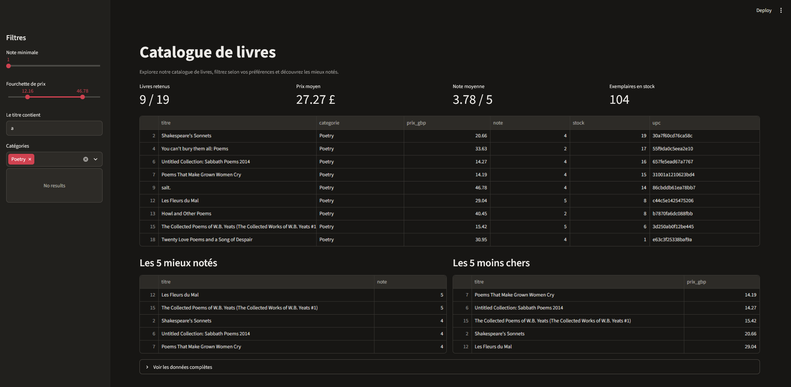

# 📚 Catalogue Explorer — The Future of Book Intelligence™

### 🚀 Disrupting Literature. Empowering Minds. Scaling Knowledge.

> **Une solution data-driven, user-centric et scalable qui transforme l'exploration littéraire en insights actionnables pour maximiser le ROI intellectuel et accélérer la croissance cognitive.**

Bienvenue dans **Catalogue Explorer**, une plateforme interactive de nouvelle génération développée avec Python, Pandas et Streamlit.

Notre mission ? Révolutionner l'accès à la connaissance en transformant un catalogue de **19 livres** en un écosystème décisionnel à haute valeur ajoutée.

Parce qu'au XXIe siècle, choisir un livre ne devrait plus relever de l'intuition, mais d'une **stratégie analytique orientée performance**.

## 🎯 Notre proposition de valeur

Grâce à une architecture *lightweight*, *agile* et *future-ready*, Catalogue Explorer permet de :

- 🔎 **Disrupter la recherche littéraire** grâce à un moteur de filtrage multicritère : note minimale, prix, titre et catégorie.
- 📊 **Piloter des KPI stratégiques en temps réel** : nombre de références, prix moyen, note moyenne et disponibilité des stocks.
- 🏆 **Identifier les opportunités de lecture à fort potentiel** grâce aux Top 5 des ouvrages les mieux notés et les moins chers.
- 🧠 **Transformer la donnée brute en intelligence décisionnelle** via des tableaux interactifs.
- ⚡ **Optimiser les performances opérationnelles** grâce à la mise en cache des données.

**Notre avantage concurrentiel ?** Une expérience utilisateur sans friction, sans SQL, sans connaissance de Python, et surtout sans réunion de cadrage.

## 🖥️ Notre plateforme en action

<!-- PLACEHOLDER : enregistrer une capture sous images/catalogue.png -->



*Interface décisionnelle de nouvelle génération : filtres interactifs, KPI dynamiques et visualisation des opportunités littéraires.*

## 🏗️ Notre stack technologique

| Technologie | Contribution stratégique |
|---|---|
| **Python** | Orchestration du moteur de croissance cognitive |
| **Pandas** | Transformation des données en insights actionnables |
| **Streamlit** | Expérience utilisateur interactive et user-centric |
| **CSV** | Infrastructure de stockage lightweight et souveraine |
| **Git / GitHub** | Gouvernance du code, traçabilité et excellence opérationnelle |

**Architecture actuelle :** un fichier `app.py`, un CSV et une ambition sans limites.

## 🚀 Déploiement de notre écosystème

### 1. Cloner le dépôt

```bash
git clone https://github.com/Nedakh-aka/app-catalogue.git
cd app-catalogue
```

### 2. Installer les dépendances

```bash
pip install -r requirements.txt
```

### 3. Lancer la plateforme

```bash
streamlit run app.py
```

L'application s'ouvre dans votre navigateur, généralement à l'adresse `http://localhost:8501`.

**Aucune infrastructure cloud, aucun cluster Kubernetes et aucune levée de fonds ne sont nécessaires.**

## 📂 Architecture de la solution

```text
app-catalogue/
├── app.py                 # Application Streamlit
├── data/
│   └── livres_poetry.csv  # Catalogue de livres
├── images/
│   └── catalogue.png      # Capture d'écran à ajouter
├── requirements.txt       # Dépendances Python
└── README.md              # Vision stratégique et documentation
```

## 📈 Scalabilité & roadmap

Notre plateforme repose sur une architecture modulaire, pensée pour accompagner la transformation digitale de l'écosystème littéraire.

**Capacité actuelle :** 19 références.

**Objectif stratégique :** 20 références.

Cela représente une croissance potentielle du portefeuille de **5,26 %**.

*Une telle montée en charge nécessitera une évaluation approfondie de notre stratégie d'hypercroissance.*

## 🌍 Origine des données

Les données proviennent de [Books to Scrape](https://books.toscrape.com/), un site de démonstration destiné à l'apprentissage de la collecte et du traitement des données.

Le catalogue utilisé contient 19 ouvrages de la catégorie *Poetry*.

Ce projet a été réalisé dans le cadre d'un exercice de formation Data Analyst, avec pour objectif la manipulation de données Pandas et la création d'une interface interactive avec Streamlit.

---

### 💡 Notre vision

*« Nous ne vendons pas des livres. Nous ne vendons même rien du tout.*

*Nous créons des synergies entre des données CSV et des décisions de lecture, pour propulser l'humanité vers un futur cognitivement scalable. »*

**Catalogue Explorer™ — Think Big. Read Smart. Filter Hard.**